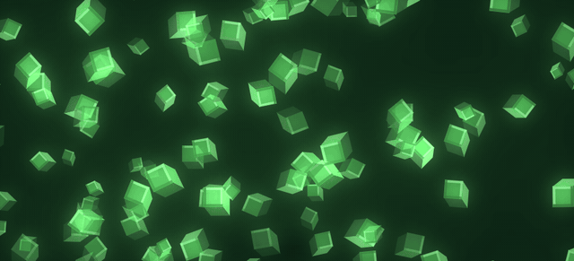
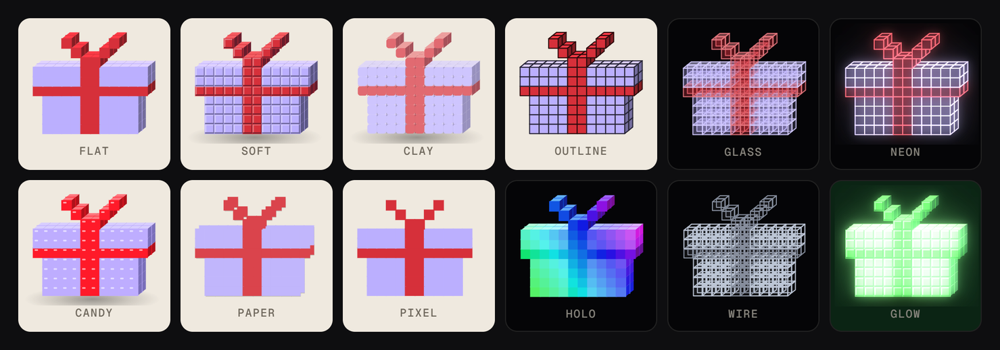
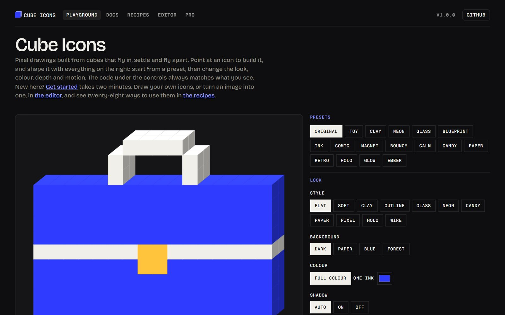
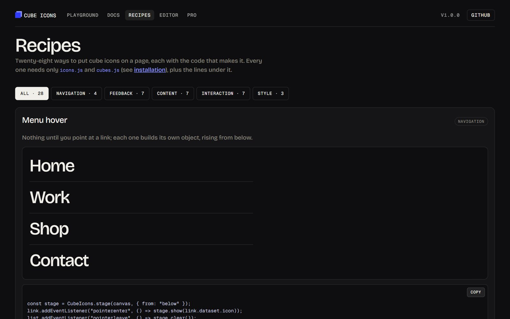
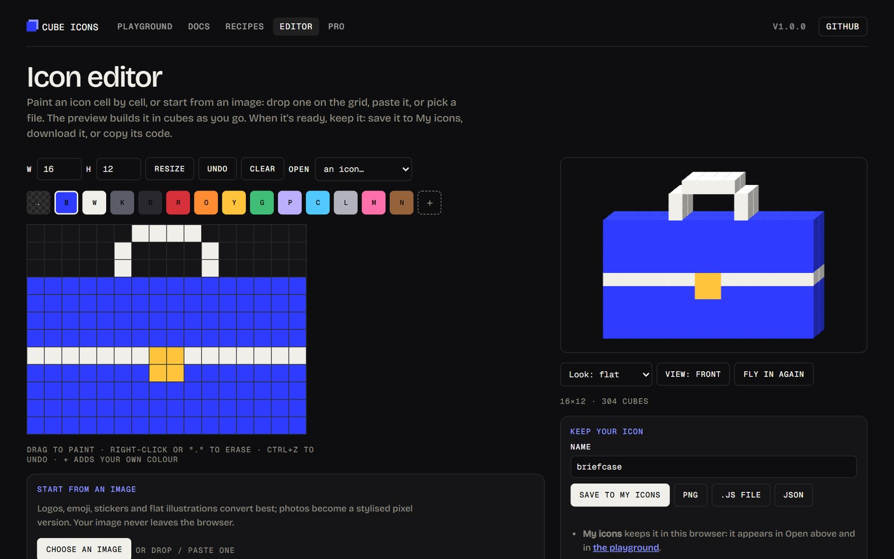
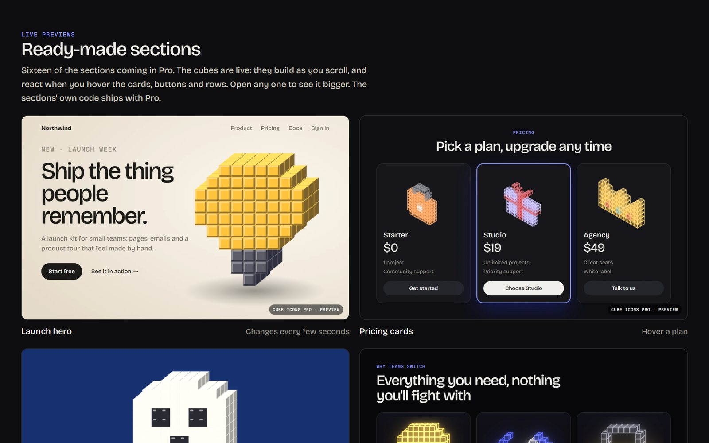

<p align="center">
  <a href="https://cube-icons.attwa.me"></a>
</p>

<h1 align="center">Cube Icons</h1>

<p align="center">
  Animated pixel icons built from 3D cubes. They fly in, settle, and fly apart:<br>
  on hover, on scroll, or whenever you say. One script, no dependencies, works on any website.
</p>

<p align="center">
  <a href="https://cube-icons.attwa.me"></a>
  <a href="https://github.com/atwalabs/cube-icons/releases/tag/v1.0.0"></a>
  <a href="LICENSE"></a>
  
  
</p>

<p align="center">
  <a href="https://cube-icons.attwa.me"><b>Playground</b></a> ·
  <a href="https://cube-icons.attwa.me/docs.html"><b>Docs</b></a> ·
  <a href="https://cube-icons.attwa.me/examples.html"><b>28 recipes</b></a> ·
  <a href="https://cube-icons.attwa.me/editor.html"><b>Editor</b></a> ·
  <a href="https://cube-icons.attwa.me/pro.html"><b>Pro</b></a>
</p>

<p align="center">
  
</p>

## Eleven looks, one option

<p align="center"></p>

`look: "flat" | "soft" | "clay" | "candy" | "paper" | "outline" | "pixel" | "glass" | "neon" | "wire" | "holo"`, plus `glow`, `tint` and `float` to taste. Fifteen ready presets in [the playground](https://cube-icons.attwa.me).

## What's inside

- **61 icons**, plus pixel text for any word, and icons with their own colours
- **11 looks**: flat, soft, clay, candy, paper, outline, pixel, glass, neon, wire, holo, and 15 presets in the playground
- **Smooth motion**: clock-timed flights with an expo ease-out curve, spin, colour blending and stagger, the same on every screen
- **Interactions**: hover menus, scroll-built sections, explode, magnet, morph sequences, loaders, a burst transition, and loose cubes that drift and gather
- **Glow and float**: bloom around the cubes, and gentle idle motion
- **An editor** that turns images into icons in your browser, and saves, downloads or exports them
- **A Claude skill**, so Claude can draw icons and wire them into your pages
- About **9 KB** gzipped for the engine. A plain 2D canvas, no WebGL. Respects reduced motion.

<table>
  <tr>
    <td width="50%"><a href="https://cube-icons.attwa.me"></a><br><b>Playground.</b> Every option and preset, with the code to copy.</td>
    <td width="50%"><a href="https://cube-icons.attwa.me/examples.html"></a><br><b>28 recipes.</b> Menus, buttons, loaders, scroll, text, and more, each with its code.</td>
  </tr>
  <tr>
    <td width="50%"><a href="https://cube-icons.attwa.me/editor.html"></a><br><b>Editor.</b> Paint icons, or drop in an image to convert it. Save, download or copy.</td>
    <td width="50%"><a href="https://cube-icons.attwa.me/pro.html"></a><br><b>Pro, coming soon.</b> 16+ ready-made sections, 300+ icons, components and export.</td>
  </tr>
</table>

## Install

Add the two scripts before `</body>`, from the CDN:

```html
<script src="https://cdn.jsdelivr.net/gh/atwalabs/cube-icons@1.0.0/icons.js"></script>
<script src="https://cdn.jsdelivr.net/gh/atwalabs/cube-icons@1.0.0/cubes.js"></script>
```

Or download [`icons.js`](icons.js) and [`cubes.js`](cubes.js) and serve them yourself.

## Quick start

```html
<canvas id="hero-icon" style="width:360px;height:280px" role="img" aria-label="A rocket"></canvas>

<script>
  const stage = CubeIcons.stage(document.getElementById("hero-icon"), { look: "soft" });
  stage.show("rocket");
</script>
```

The canvas needs a CSS width and height; the icon scales to fit. Shape everything else in the [playground](https://cube-icons.attwa.me), whose code box gives you the matching line to paste.

## Common uses

```js
// a menu: build on hover, fly apart on leave
link.addEventListener("pointerenter", () => stage.show("briefcase"));
menu.addEventListener("pointerleave", () => stage.clear());

// build as the section scrolls into view
CubeIcons.scroll(stage, "rocket");

// progress, bottom row first, then a tick
stage.build("rocket", progress);

// a word
stage.show(CubeIcons.text("Hello"));
```

[The recipes](https://cube-icons.attwa.me/examples.html) have twenty-eight working examples. [The docs](https://cube-icons.attwa.me/docs.html) cover React, Next.js, Vue, Svelte, Framer, Webflow and WordPress, every option, and the full API.

## Your own icons

An icon is rows of palette keys; `.` is empty:

```js
stage.show([
  ".RR...RR.",
  "RRRR.RRRR",
  "RRRRRRRRR",
  ".RRRRRRR.",
  "..RRRRR..",
  "...RRR...",
  "....R....",
]);
```

Draw them in [the editor](https://cube-icons.attwa.me/editor.html), or drop an image on it to convert. Keep them in My icons (in your browser), or download a PNG, a `.js` file or JSON; or copy an `icons.js` entry or a complete drop-in snippet. Icons can carry their own colours: `{ colors: { a: "#eb234f" }, rows: ["aa.."] }`.

## Use with Claude

The [`skill/cube-icons`](skill/cube-icons) folder is a Claude skill. In Claude Code, copy it to `~/.claude/skills/cube-icons`. In the Claude apps, zip the folder and upload it under Settings → Capabilities → Skills. Then ask for things like *"add a cube icon menu to my landing page"*.

## Browser support

Current Chrome, Edge, Firefox and Safari. The neon glow uses canvas filters and falls back to plain bright edges where they aren't supported.

## Licence and credits

MIT: free for personal and commercial use. See [LICENSE](LICENSE).

The idea of a cube swarm that builds an object per menu item was inspired by the menu on [sparkk.fr](https://sparkk.fr). Cube Icons is an independent, dependency-free take that builds its shapes from pixel art. Related work: [heerich.js](https://github.com/meodai/heerich), [claude-pxl](https://github.com/crsolver/claude-pxl).

**Cube Icons Pro** is coming, with 300+ icons, ready-made sections, framework components and export, for a one-time payment. [Preview it](https://cube-icons.attwa.me/pro.html).
